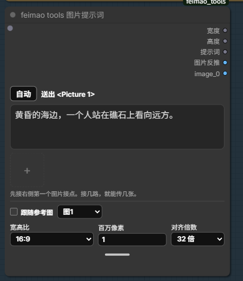
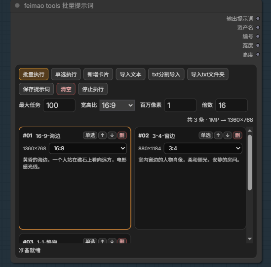
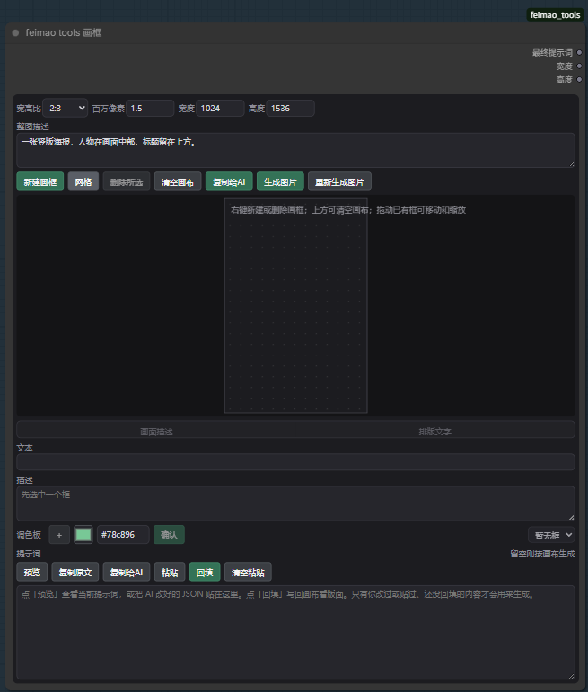
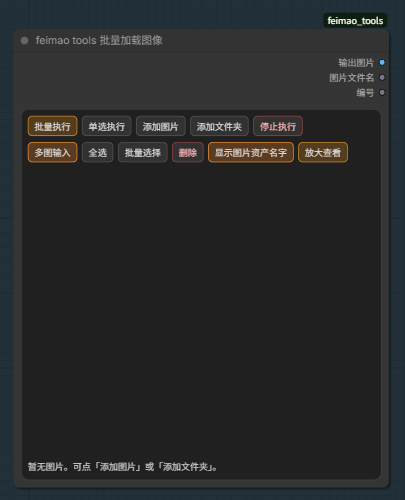
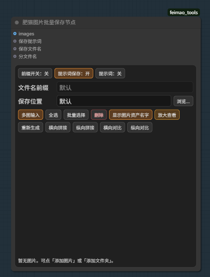

# feimao tools

ComfyUI 自定义节点 · 分类名 `feimao tools`

写提示词 · 反推 · 定尺寸 · 画框 · 批量读图和存图

 

[安装](#安装) · [演示工作流](#演示工作流) · [节点介绍](#节点介绍) · [更新日志](CHANGELOG.md)

 

<a href="https://space.bilibili.com/280681975"><b>B 站肥猫 AIGC</b> · 工作流怎么串，看这里的视频</a>

---

## 安装

<table>
<tr>
<td width="50%" valign="top">
把本仓库文件夹放进 <code>ComfyUI/custom_nodes/</code>，重启 ComfyUI，再刷新浏览器。
  
图片提示词底部的「跟随参考图」是这次新加的。ComfyUI 已经开着的话，重启一次并刷新页面后才会出现。
</td>
<td width="50%" valign="top">
<b>打开演示</b>
  
仓库里的 <a href="workflows/肥猫tools演示.json"><code>workflows/肥猫tools演示.json</code></a> 把核心节点摆在同一张图上，节点之间没有连线，用来看界面。在 ComfyUI 里直接打开这个文件即可。
</td>
</tr>
</table>

## 节点介绍

[图片提示词](#图片提示词) · [批量提示词](#批量提示词) · [批量反推](#批量反推) · [画框](#画框) · [生图尺寸](#生图尺寸) · [批量加载图像](#批量加载图像) · [批量保存](#批量保存)

### 图片提示词

<table>
<tr>
<td width="48%" valign="middle">
上面写提示词，输入 <code>@</code> 引用下面上传的图。右侧图片接点接上一路，下面再出现一个接点。上传了几张就按顺序送出几张，没上传的空槽送出空值。
<ul>
<li>引用格式选「自动」时，接到 H3 送 <code>&lt;Picture N&gt;</code>，接到千问送 <code>&lt;imageN&gt;</code></li>
<li>宽高比、百万像素和对齐倍数会算出宽度和高度</li>
<li>打开「跟随参考图」后，宽高改用所选参考图的像素尺寸，默认图 1，也可以改选后面的图</li>
</ul>
</td>
<td width="52%" align="center">

</td>
</tr>
</table>

### 批量提示词

<table>
<tr>
<td width="46%" align="center">

</td>
<td width="54%" valign="middle">
一条卡片一条提示词。标题写成 <code>16-9-海边</code> 这种格式时，用标题里的宽高比算出这一条的宽高。标题里没有比例时，用节点上的默认宽高比。
<ul>
<li>批量执行，或只跑选中的一条</li>
<li>从文本、txt 或文件夹导入</li>
<li>输出提示词、资产名、编号、宽度和高度</li>
</ul>
</td>
</tr>
</table>

### 批量反推

<table>
<tr>
<td width="52%" valign="middle">
接上 Qwen 模型和图片，点「开始反推」。
<ul>
<li>一键复制整段结果</li>
<li>复制给 AI，接着改提示词</li>
<li>复制成九宫格或六宫格提示词</li>
</ul>
</td>
<td width="48%" align="center">

</td>
</tr>
</table>

### 画框

<table>
<tr>
<td width="44%" align="center">

</td>
<td width="56%" valign="middle">
按宽高比和百万像素算出宽度和高度，接到空 Latent。整图描述写在节点上。
<ul>
<li>画布里新建、拖动和缩放画框</li>
<li>把版面复制给 AI，或把改好的 JSON 贴回来</li>
<li>粘贴提示词里有内容时，生成用贴进来的文本</li>
</ul>
</td>
</tr>
</table>

### 生图尺寸

<table>
<tr>
<td width="55%" valign="middle">
没开自定义尺寸时，宽度和高度跟着宽高比、百万像素和对齐倍数。
  
打开自定义尺寸后，才使用手填的宽高，并按对齐倍数取整。
</td>
<td width="45%" align="center">

</td>
</tr>
</table>

### 批量加载图像

<table>
<tr>
<td width="46%" align="center">

</td>
<td width="54%" valign="middle">
添加图片或整个文件夹，按当前条目输出图片、文件名和编号。
  
可以批量执行，也可以只跑选中的一张。
</td>
</tr>
</table>

### 批量保存

<table>
<tr>
<td width="54%" valign="middle">
保存生成图。文件名可以用前缀、保存文件名和分文件名，保存位置可以改。
<ul>
<li>提示词可以写入 PNG</li>
<li>多张图可以横向或纵向拼接</li>
<li>也可以直接做成对比图</li>
</ul>
</td>
<td width="46%" align="center">

</td>
</tr>
</table>

## 同包里的其他节点

演示工作流里还有这几个，界面比较直，这里只列用途。

| 节点 | 做什么 |
| --- | --- |
| 使用模型 | MOSS、千问、Krea2、Z-image 里只执行当前选中的一路，没接上的模型不会跑。默认 MOSS |
| 使用放大 | VOSR2 和 SeedVR2 里只执行当前选中的一路。默认 VOSR2 |
| 模型对比 | 勾选要跑的模型，按顺序横向或纵向拼成一张对比图。打开「正常出图」则分成多张 |
| 缩放图像（像素） | 按百万像素缩放参考图。没接到图时送出空值 |
| 批量图像 | 把多张参考图拼成一批。空着的图片口会跳过 |

`assets/` 里有两张分镜网格底图，给九宫格和六宫格提示词用。

---

更新记录见 [CHANGELOG.md](CHANGELOG.md)

用法视频：[肥猫 AIGC](https://space.bilibili.com/280681975)

