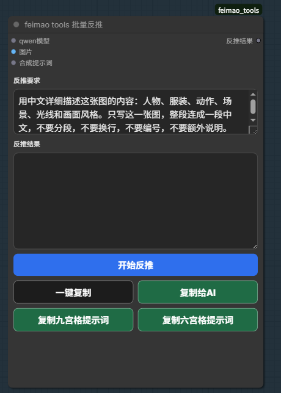
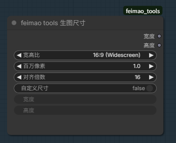

# feimao tools

ComfyUI 自定义节点，分类名是 `feimao tools`。用来写提示词、反推、定尺寸、画框、批量读图和存图。

具体怎么串进工作流，看 B 站肥猫 AIGC 的视频：[https://space.bilibili.com/280681975](https://space.bilibili.com/280681975)

## 安装

把本仓库文件夹放进 `ComfyUI/custom_nodes/`，重启 ComfyUI，再刷新浏览器。

图片提示词底部的「跟随参考图」是这次新加的。已经开着 ComfyUI 的话，重启一次并刷新页面后才会出现。

## 演示工作流

`workflows/肥猫tools演示.json` 把下面这些节点摆在同一张图上，节点之间没有连线，用来看界面。在 ComfyUI 里直接打开这个文件即可。

## 图片提示词

上面写提示词，输入 `@` 引用下面上传的图。右侧图片接点接上一路，下面再出现一个接点。上传了几张就按顺序送出几张，没上传的空槽送出空值。

引用格式选「自动」时，接到 H3 送 `<Picture N>`，接到千问送 `<imageN>`。

宽高比、百万像素和对齐倍数会算出宽度和高度。打开「跟随参考图」后，宽高改用所选参考图的像素尺寸，默认图 1，也可以改选后面的图。这时宽高比、百万像素、对齐倍数不再影响尺寸。

## 批量提示词

一条卡片一条提示词。标题写成 `16-9-海边` 这种格式时，用标题里的宽高比算出这一条的宽高；标题里没有比例时，用节点上的默认宽高比。

可以批量执行、单选执行，也可以从文本、txt 或文件夹导入。输出提示词、资产名、编号、宽度和高度。

## 批量反推

接上 Qwen 模型和图片，点「开始反推」。结果可以一键复制、复制给 AI，也可以复制成九宫格或六宫格提示词。

## 画框

按宽高比和百万像素算出宽度和高度，接到空 Latent。整图描述写在节点上。画布里可以新建、拖动和缩放画框，再把版面复制给 AI，或把改好的 JSON 贴回来。

粘贴提示词里有内容时，生成用贴进来的文本。

## 生图尺寸

没开自定义尺寸时，宽度和高度跟着宽高比、百万像素和对齐倍数。打开自定义尺寸后，才使用手填的宽高，并按对齐倍数取整。

## 批量加载图像

添加图片或整个文件夹，按当前条目输出图片、文件名和编号。可以批量执行，也可以单选执行。

## 批量保存

保存生成图。文件名可以用前缀、保存文件名和分文件名，保存位置可以改。提示词可以写入 PNG。多张图可以横向或纵向拼接，也可以做成对比图。

## 同包里的其他节点

演示工作流里还有这几个，界面比较直，这里只列用途：

- **使用模型**：MOSS、千问、Krea2、Z-image 里只执行当前选中的一路，没接上的模型不会跑。默认 MOSS。
- **使用放大**：VOSR2 和 SeedVR2 里只执行当前选中的一路。默认 VOSR2。
- **模型对比**：勾选要跑的模型，按顺序横向或纵向拼成一张对比图。打开「正常出图」则分成多张，不拼在一起。
- **缩放图像（像素）**：按百万像素缩放参考图。没接到图时送出空值。
- **批量图像**：把多张参考图拼成一批。空着的图片口会跳过。

`assets/` 里有两张分镜网格底图，给九宫格和六宫格提示词用。

## 更新日志

见 [CHANGELOG.md](CHANGELOG.md)。
